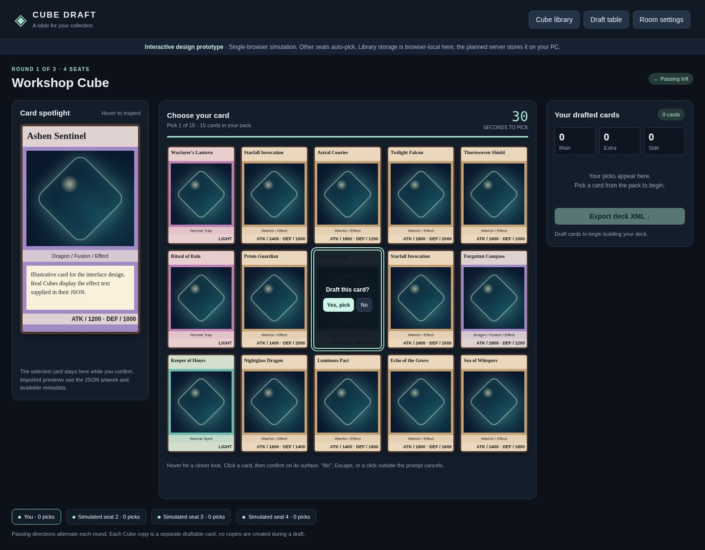

# Drafting platform design

A first interface and architecture for hosting Cube Draft on your Windows PC.
Read [DESIGN.md](DESIGN.md) for server responsibilities, storage, network access,
privacy, the current extension JSON contract and implementation milestones.



## Server-rendered card images

The rendering proof of concept generates card images on the PC server from JSON
and locally stored backgrounds, border, icons, fonts and artwork. See the
[renderer proof of concept](renderer/README.md) for its Node.js start command,
local asset manifest, visual metadata contract and sample gallery. It caches
self-contained SVGs and includes a credited frame/icon/font pack. Card artwork
and exact visual matching still require validation.
The same local server now serves the drafting interface at
**http://127.0.0.1:3210/draft**. Run
`node platform-design/server.cjs` from the repository root with Node.js 24
(the version used for the SQLite catalog checks). The server entry
point and room logic live in this folder. The `renderer/` folder provides card
rendering, assets, and the gallery and typography tester. Pack cards
and the spotlight share cached rendered SVGs, including the selected typography.
The spotlight keeps the current card in place until the next image is decoded,
then swaps it without showing the basic preview between rendered cards.
The draft table fills the available page width with compact pack cards and a
rendered deck grid. Hover or focus either grid to inspect the spotlight and its
larger card text, monster rating or Spell/Trap subtype below the image.
The spotlight stays visible within the screen. Its bounded text panel
scrolls long effects internally, with monster attribute/type and rating/stats
on separate rows. Pack cards expand to fill their row with equal left/right
margins. Their size depends on viewport space and the preferred column density,
independent of the current or configured pack count. Packs scroll internally when the cards exceed the panel height;
drafted cards fill each row with compact margins and scroll internally when needed.
Pack card dimensions stay stable as picks are made. The pick confirmation has
YES and NO side by side, with Zoom
on its own row below.
The Cube name appears beside the site title. Round, passing direction and player
status share the middle-panel header, including after the draft; no separate
top status row or bottom player strip takes space from the card panels.
The application fills the viewport without page scrolling. Drafted cards retain
their size as the deck grows within each layout, with internal scrolling on smaller displays. Long effects,
large cube libraries and room settings scroll internally when necessary.
XML export unlocks once every pick is complete, the Main Deck has the configured
number of cards, and all exported cards have confirmed DuelingBook IDs.
After the draft, Main uses four rows of ten cards with 2px horizontal and vertical
gaps. The center panel fits that compact row width, giving spare screen width to
the spotlight and deck menu. Additional cards overlap within the same row span.
The extra final-deck heading and bottom Draft rules/notes are omitted.
Larger Main Decks overlap horizontally within those four rows. Side and Extra use
their own rows and overlap horizontally when needed. Card dimensions stay fixed;
Main, Side and Extra scroll within the final deck panel when they overflow.
Hovering or focusing a card brings it
above its neighbors.
The deck amounts use four rows during and after drafting: Total, Main, Side and
Extra. Main and Side show their total, then miniature blank effect-monster, Spell
and Trap frames beside each type count. The miniatures have black artwork and no
card text or stats. Extra shows Fusion, Xyz, Synchro and Link frames in that order,
including only types present in the Extra Deck. Counts update after picks and
Main/Side swaps. The visible heading and count badge are omitted to leave more
space for cards. Shared columns right-align section names, left-align type quantities,
center section totals, and keep miniature frames aligned across rows regardless
of digit count. End drafting session and Export to XML sit beside the counters at
the upper right, with End above Export. Narrow screens place the buttons below
the counters. The final right-hand deck menu also holds sorting controls.
Toggle Monster → Spell → Trap grouping (monsters
follow Normal → Effect → Ritual, then Fusion → Synchro → Xyz → Link),
then sort within each group by ATK, DEF, Level (including Rank/Link rating) or
card name in either direction. Without grouping the selected order applies to
the entire deck. Equal numeric values use alphabetical names as a tie-breaker
in either direction. Missing numeric values stay last; XML follows the chosen order
within Main, Extra and Side.
The default is grouping enabled, sorted by Level in descending order.
Supported DuelingBook artwork is downloaded into a local cache on first use.
The gallery remains at `/` and the typography tester at `/tester`.
Its [typography tester](renderer/README.md#typography-and-spacing-tester) adjusts
fonts, star gaps and ATK/DEF spacing, and saves the chosen style to the renderer.
It can also be generated as a single HTML file to open without a server.

## Try the interface

Download **index.html** using GitHub's **Download raw file** button and open the
saved file in Chrome or Edge for the basic HTML card previews. For the full
card renderer, use the local `/draft` address above. GitHub's normal file view
shows source, not the running interface.

The server's `/draft` page opens **Draft rooms**. Enter a nonblank player name to
enable **Join Room** and **Create Room**. Join asks for an existing eight-character
room code. Create asks for 2–6 allowed players, including the host, and opens a lobby
with a generated code. **Copy code** copies it to the clipboard.

The lobby lists joined players and empty seats. Only the host can select a Cube,
set Main Deck quantity (20–60, default 40), packs per player (1–12), cards per pack
(1–30), and seconds per pick (0–300). **0 means no time limit** for human picks. Bots still pick automatically.
Import Cubes through the Cube library, then select one in the lobby and
choose **Save settings**. Guests see saved settings as read-only. **View Cube cards**
opens a searchable, paginated gallery of every card in the selected Cube, including
copy counts, for both hosts and guests.

The built-in **Mock Cube · 300 cards** is always listed in the Cube library and
selector, and is selected by default for new rooms. It contains 300 distinct
fictional cards, one copy each, with generated local illustrations, types,
attributes, ratings, stats and effect text. It works with human players, bots, or
both. Its artwork needs no downloads; mock cards have no real DuelingBook IDs and
cannot be exported as real cards.

The server stores imported cards once by card ID in
`platform-design/renderer/data/cubes.sqlite`. Each Cube has its own membership
and copy counts. In **Cube library**, enter a name and choose **Create Cube**,
then **Edit Cube** to rename or delete it. Choose a specific **Source Cube**,
search its cards, and use **Add one**. Cards in the editor have **Copies**, **Save**,
and **Remove** controls; copies must be whole numbers from 1 to 1,000. Other
players can view and use shared Cubes, while only the browser that created a
Cube can edit it. **Refresh Cubes** loads Cubes added by other players. Existing
Cubes saved in this browser are imported into the server catalog on first load.
The built-in Mock Cube remains a separate starter Cube. Rooms retain a Cube
snapshot after selection; save room settings again to use later Cube edits.

Before drafting starts, the host sees **Add bot** on every empty player slot and
**Remove** on every occupied slot except their own. Bots take the selected slots,
make random legal picks on the server (including with no time limit), and persist
through server restarts. A removed guest returns to the entry screen and can join
or create another room. Guests cannot manage seats. Seat changes lock once the
draft starts to preserve pack passing and picked cards.

The host's **Start Draft** becomes available once every seat contains a player or bot,
settings are valid, and the selected Cube has enough copies for the configured
packs. Starting saves pending settings before beginning the draft. Saved rooms
without a selected Cube offer the Mock Cube by default. **Save settings** can still
publish changes to guests before starting. **Draft rooms** returns to the lobby during a draft; **Return to draft**
reopens the table. Anyone connected can host a room; no account is required.
During or after a draft, only the host sees **End drafting session** in the deck
panel and Room settings. Confirming returns everyone to the same lobby, keeps the
room code, active players, bots, Cube and settings, and resets picks and timers for
the next draft. The previous session is saved privately on the server under
`platform-design/renderer/data/rooms/sessions/<room-code>/<session-id>.json`.
Guests who already left a completed session remain out of the room. The host can
change settings and start another draft without creating a new room.
In **Room settings**, the host can choose **Close room for everyone** and confirm
to end the room. Guests see **Leave room**, available before drafting or after
the draft completes; during drafting they can ask the host to close the room.
These controls work independently of XML export validation. Leaving a completed
room preserves its saved decks and frees the guest to create or join another room.
Unchanged room snapshots leave focused controls, selected text and card readers
in place. Other players' picks update their seat status without rebuilding your
pack. The served page requests a content-versioned room script so refreshes pick
up fixes without clearing your saved seat.

Picks and alternating pack passing are controlled by the server. Packs pass once
every seat has picked. The server auto-picks for missing players at the deadline,
including while they are disconnected. Rooms, Cube copies, shuffled stock, private
packs, picks, deadlines and final Main/Side assignments are atomically saved under
`platform-design/renderer/data/rooms/`. Restart with the same data directory to
recover them. Each browser retains a private resume credential: reloading or
returning to `/draft` resumes its latest room automatically. **Resume saved room** retries
after a connection failure. Keep browser storage to retain access to your seat;
the public room code does not reclaim an occupied seat. Clearing storage or
switching devices currently requires a new seat in a new room. A persistent browser
identity allows only one room at a time. Hosts must **Close room** before creating
another; guests can **Leave room** from the lobby. Closing notifies all members and
retains saved draft files. The one-room rule uses browser storage, not an account
shared across devices.

The separate simulator page has been removed. Use the same draft room with bots
for solo practice. The shared room contains the host's selected Cube; the Cube
library is shared through the server, while the mock Cube is built in.

### Access from other computers

For friends on **different internet connections**, use the remote launcher from
PowerShell (Windows PowerShell 5.1 or PowerShell 7):

```powershell
& "D:\YGO Cube Draft\Yu-Gi-Oh-DuelingBook-Cube-Feature\scripts\start-remote-draft.ps1"
```

This downloads a pinned official Windows x64 Cloudflare Tunnel binary, checks its
SHA-256, starts the Node server with `--public`, and prints a temporary HTTPS
`trycloudflare.com` address. Open that **same public address** yourself, enter your
name and create a room. Send friends the address and room code; they enter their
names and choose **Join room**. No LAN connection or router port forwarding is
required. The public server serves drafting, room APIs and card renders; gallery
and typography administration routes return 404.

Keep the host PC awake and online. Stop sharing with:

```powershell
& "D:\YGO Cube Draft\Yu-Gi-Oh-DuelingBook-Cube-Feature\scripts\stop-remote-draft.ps1"
```

Saved rooms remain on disk. The quick tunnel address changes when restarted;
because browser credentials belong to the original address, use a stable domain
and named tunnel for ongoing drafts/reconnects across tunnel restarts. Quick
tunnels are for temporary testing, not permanent hosting. Logs and process IDs
are kept in ignored `platform-design/renderer/data/remote-host/`. The launcher
requires an available port (3210 by default) and stops its own newly started
processes if startup fails. It does not modify firewall rules or install services.
See [Cloudflare Quick Tunnels](https://developers.cloudflare.com/tunnel/get-started/quick-tunnels/).

For a LAN test, start the server in PowerShell from the repository root:

```powershell
$env:HOST = '0.0.0.0'
node platform-design/server.cjs
```

Players open `http://<host-PC-LAN-IP>:3210/draft`; allow the chosen port through
the host's firewall. `PORT` overrides 3210. `DATA_ROOT` selects a persistent data
directory. By default the server uses `platform-design/renderer/data/`, so
existing rooms, fonts, styles, and caches are loaded from the same location.
Back up the data directory while the server is stopped. Run one server process
per data directory. The default bind address is `127.0.0.1`.

Permanent internet hosting requires a stable HTTPS endpoint/reverse proxy and deployment
configuration. Publish `/draft`, `/room-client.js`, `/cube-library.js`, `/mock-cube.js`, `/mock-art/*`,
`/draft-renderer.js`, `/api/cubes`, `/api/cubes/*`, `/api/rooms`,
`/api/rooms/*`, `/api/draft-render`, and `/renders/*`; keep the gallery and typography
administration routes private. Resume credentials grant access to a seat and must
travel over HTTPS outside a trusted LAN. No hosting or firewall changes are made
by the application. Room storage currently supports 500 rooms; archival, account
recovery and abuse controls remain follow-up work before a public launch.
The `/draft` page opens the room entry screen without starting a session or timer.
Create a room, choose a Cube, fill its seats with players or bots, and start explicitly.

Try these interactions:

1. Create a room, keep the Mock Cube selected, add bots, and start drafting.
   Hover cards to change the left spotlight.
   Click a card, then Yes to draft it, or Zoom for a larger reader with the
   card on the left, text on the right, and Confirm pick / Close buttons at the top.
   Cards already drafted also open Zoom during the session.
   No, Escape and clicking outside the prompt cancel without resetting the timer.
2. Leave a confirmation open until time runs out: a random remaining card is
   picked and the obsolete confirmation closes.
3. Open Room settings. Try 2–6 players and change packs/player, cards/pack and
   seconds/pick. Main Deck size defaults to 40 and accepts 20–60 cards.
   The capacity check uses the Cube's actual copy counts.
4. Open Cube library and upload an extension `dbcd-cube-v1` JSON. Reload and check
   that it remains listed. Choose Use this Cube to select it in your room settings.
5. Complete a small draft (e.g. 2 players, 2 packs/player, 3 cards/pack). Check that
   passing changes from left to right in round 2 and the deck gains six cards.
6. Fusion, Synchro, Xyz and Link monsters stay in Extra. Other picks fill Main
   up to the configured size; surplus cards go to Side, displayed below Main.
   Drag a Main card onto a Side card (or vice versa) to exchange their exact slots
   without changing deck sizes. Extra Deck cards stay separate. Changing a sort
   control reapplies that sorting after manual swaps.
   Clicking a final card opens the larger reader, with Close at the top.
   Export XML after the draft ends, Main is full and all cards have numeric
   DuelingBook IDs. Fictional mock cards have
   no real IDs, so their export is deliberately unavailable.

`--deck-card-width` sets the drafted-card density (80px by default). During drafting,
cards expand across each row; the final deck uses that preferred width in its
section layout. Slim, balanced scrollbar gutters keep both grids close to their
side edges. Pack dimensions remain independent.

Visual sizing controls are grouped under the `Visual tuning` comment in
`index.html`: `--spotlight-scale: .8` is 80% of the original spotlight size
(try `.75` or `.85` for small adjustments), and `--pack-card-width: 125px` sets
the preferred width used to choose the number of columns. Cards expand across
the available row, preserving that size as cards are picked. The 4px hover outline uses a
-2px offset so half lies inside the card edge. Main/Side swaps move existing
decoded images instead of rebuilding the deck; revisiting a spotlight card also
reuses its decoded preview.

## Automated checks

From the repository root, with its existing Playwright dependency installed:

```sh
node --test platform-design/prototype.test.cjs platform-design/renderer/*.test.cjs
node --test platform-design/draft-renderer.test.cjs
node --test platform-design/cube-db.test.cjs
node --test platform-design/rooms.test.cjs
npm test
```

The prototype tests use a temporary local HTTP server and Chromium. Set
`CHROMIUM_PATH` to your Chromium/Chrome executable if it is not `/usr/bin/chromium`.
They cover confirmations, copy conservation, passing, timeouts, JSON compatibility
and persistence, validation, XML serialization and responsive layout.

## Still to implement and validate

- Account/device-independent seat recovery, room archival, and public-service
  rate limits. File-backed rooms currently require a single server process.
- Actual DuelingBook artwork availability and representative card previews;
  current JSON does not guarantee all full-card layout fields.
- Real DuelingBook XML round trips for custom/official IDs and deck sections.
  Direct import has no verified public API yet; native file import is the first path.
- Windows startup, LAN/internet access and backup/restore with another device.

There is no deployed multiplayer service in this branch.
