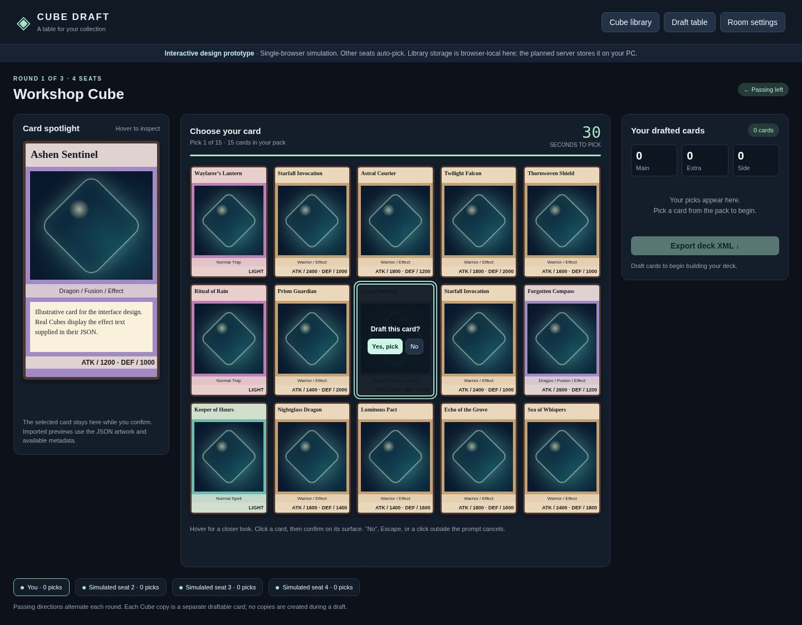

# Drafting platform design

A first interface and architecture for hosting Cube Draft on your Windows PC.
Read [DESIGN.md](DESIGN.md) for server responsibilities, storage, network access,
privacy, the current extension JSON contract and implementation milestones.



## Server-rendered card images

The rendering proof of concept generates card images on the PC server from JSON
and locally stored backgrounds, border, icons, fonts and artwork. See the
[renderer proof of concept](renderer/README.md) for its Node.js start command,
local asset manifest, visual metadata contract and sample gallery. It caches
self-contained SVGs and includes a credited frame/icon/font pack. Card artwork
and exact visual matching still require validation.
This gallery is separate from the single-file draft simulation below.

## Try the interface

Download **index.html** using GitHub's **Download raw file** button and open the
saved file in Chrome or Edge. It is self-contained: no build or installation is
needed. GitHub's normal file view shows source, not the running interface.

This is a **single-browser prototype**, not a running multiplayer server. The
other seats are simulated and pick whenever you do. Imported Cubes persist in
this browser's storage; they are not shared or saved to a PC server yet. A browser
which blocks local file storage may require serving the file over local HTTP.
Refreshing resets the simulated draft but retains successfully saved Cube imports.

Try these interactions:

1. Hover cards to change the left spotlight. Click a card, then Yes to draft it.
   No, Escape and clicking outside the prompt cancel without resetting the timer.
2. Leave a confirmation open until time runs out: a random remaining card is
   picked and the obsolete confirmation closes.
3. Open Room settings. Try 2–6 players and change packs/player, cards/pack and
   seconds/pick. The capacity check uses the Cube's actual copy counts.
4. Open Cube library and upload an extension `dbcd-cube-v1` JSON. Reload and check
   that it remains listed. Choose Use this Cube to start a new simulation.
5. Complete a small draft (e.g. 2 players, 2 packs/player, 3 cards/pack). Check that
   passing changes from left to right in round 2 and the deck gains six cards.
6. Assign picks to Main, Extra, Side or Reserve. Export XML when included cards
   have numeric DuelingBook IDs. Reserve is omitted. Fictional sample cards have
   no real IDs, so their export is deliberately unavailable.

## Automated checks

From the repository root, with its existing Playwright dependency installed:

```sh
node --test platform-design/prototype.test.cjs platform-design/renderer/*.test.cjs
npm test
```

The prototype tests use a temporary local HTTP server and Chromium. Set
`CHROMIUM_PATH` to your Chromium/Chrome executable if it is not `/usr/bin/chromium`.
They cover confirmations, copy conservation, passing, timeouts, JSON compatibility
and persistence, validation, XML serialization and responsive layout.

## Still to implement and validate

- Real guest uploads and shared persistent library on your PC.
- Independent player sessions, lobby, server timers, private packs, reconnects and
  restart recovery. The client simulation is not the production draft engine.
- Actual DuelingBook artwork availability and representative card previews;
  current JSON does not guarantee all full-card layout fields.
- Real DuelingBook XML round trips for custom/official IDs and deck sections.
  Direct import has no verified public API yet; native file import is the first path.
- Windows startup, LAN/internet access and backup/restore with another device.

There is no deployed multiplayer service in this branch.
