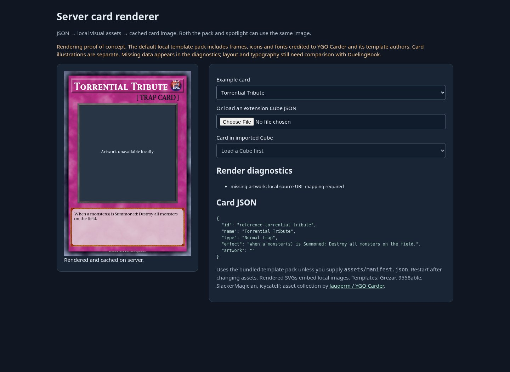
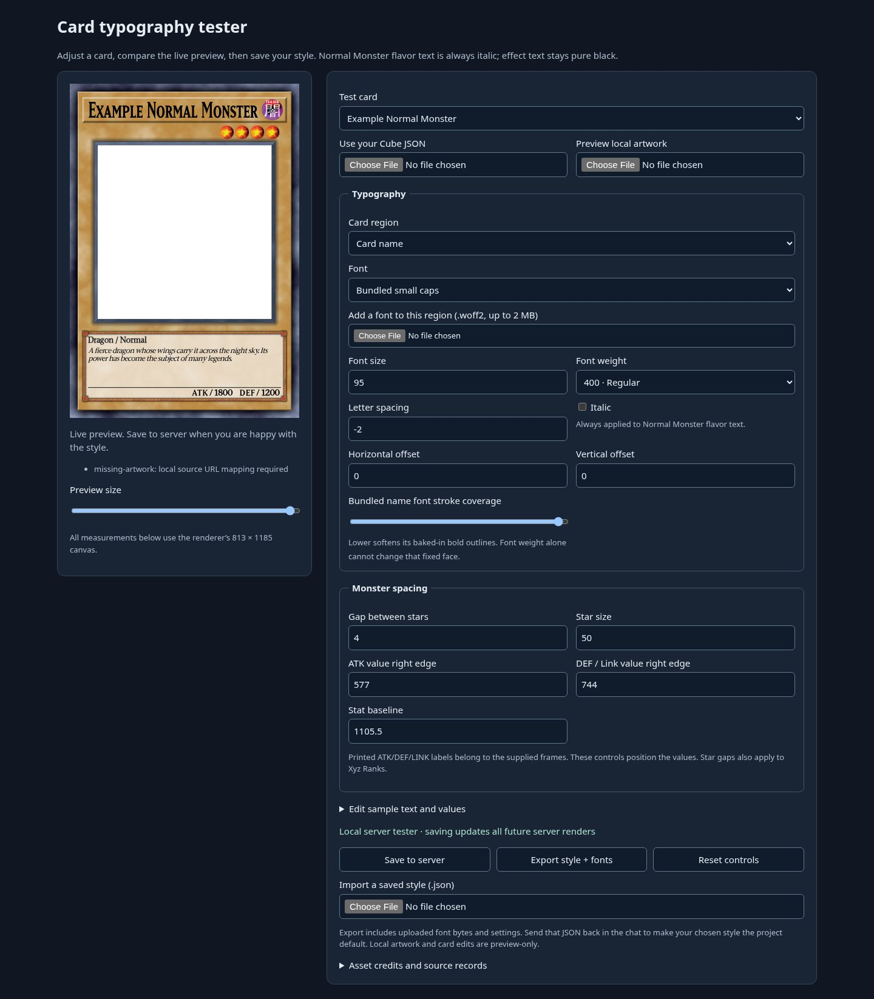
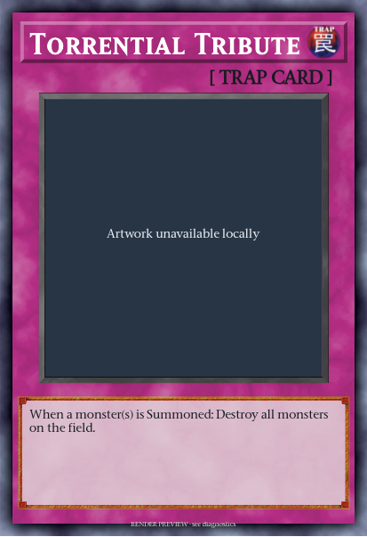

# Server-side card rendering proof of concept

The PC server combines card JSON with **local** backgrounds, border, icons, fonts
and artwork into one self-contained SVG. The gallery displays the generated image
without contacting DuelingBook. Rendered images are cached
on disk, with identity based on visual content, embedded asset bytes and renderer
version. Changes to copies/sections do not regenerate an identical card image.

The default pack uses the **ten predefined PNG frames supplied in
`ygo-renderer-card-frames.zip`**, stored byte for byte at their original
549 × 800 dimensions. See the [frame source record](packs/predefined/NOTICE.md)
and checksums in `packs/predefined/provenance.json`. Fonts, attributes and
subtype/Level/Rank icons still come from the separately credited
[YGO Carder pack](packs/ygocarder/NOTICE.md). The earlier 67-file layered pack
remains available, with its pinned upstream checksums intact. No bundled assets
came from the wiki. Card illustrations remain separate.

The local gallery uses this pack automatically unless `assets/manifest.json`
is present. Missing files/details produce diagnostics. Coordinates follow the
813 × 1185 SVG canvas, scaled from the original frames, with DuelingBook
presentation rules. Width-aware text fitting is implemented; exact matching and
non-Latin fallbacks still need real-card
comparison. This is a rendering experiment, separate from
the draft simulation and multiplayer server.



## Run on your PC

Install Node.js 24 LTS, open a terminal at the repository root, then run:

```sh
node platform-design/renderer/server.cjs
```

Open the address printed in that terminal (`http://127.0.0.1:3210`). The process
listens only on your PC's loopback interface. Set `PORT` if that port is occupied.
No npm installation is needed for the renderer itself.

The gallery has fictional Normal/Effect/Ritual/Fusion/Synchro/Xyz/Link/Pendulum,
Spell and Trap records. You can also select an extension Cube JSON and choose a
card from it. That sends one selected card to the local renderer, not the whole
Cube library. The gallery does not save Cubes, change the JSON, or perform a draft.

## Typography and spacing tester

Start the server as above, then open **http://127.0.0.1:3210/tester** or follow
the gallery's tester link. Select a sample or your Cube JSON. The tester shares
the server's SVG compositor, text fitting and style validation; its live preview
runs locally in the browser and does not fill the server render cache while you
move controls.

- Select a region: card name, main effect/flavor text, Pendulum effect,
  Spell/Trap type, monster type line, or ATK/DEF values.
- Choose a bundled font or load a **WOFF2** file. Adjust size, weight, italic,
  letter spacing and horizontal/vertical offsets. Effect regions also have
  minimum fitted size and line height. The bundled name face has one fixed set
  of outlines. For card names, weights 100–900 now simulate progressively thinner
  or thicker strokes; 400 preserves the selected original appearance. These are
  visual adjustments, not nine separate font faces. Its stroke-coverage control
  separately softens edges. Other fonts continue to use browser font-weight
  behavior.
- Adjust star size/gap, ATK and DEF/Link value positions, and the stat baseline.
  Measurements use the 813 × 1185 canvas. Printed ATK/DEF/LINK labels are part of
  the supplied PNGs; these controls change the overlaid values. Oversized star
  rows fall back to a numeric Level/Rank with a diagnostic.
- **Save to server** applies the profile immediately to subsequent renders,
  including the gallery, and retains it in `data/render-style.json` across
  restarts. Uploaded fonts are stored inside that JSON and embedded into the SVG.
  Invalid saves leave the previous profile intact. New visual output receives a
  new cache key; older cached images remain available.
- **Export style + fonts** produces a portable `card-render-style.json`. Import
  it on another server, then save, or send it back in the chat to update the
  project's defaults in `style.default.json`. A saved local profile takes
  precedence over project defaults. **Reset controls** restores the project
  defaults in the preview; save to apply them to the server.

You can also generate a **single-file offline tester**, with all default frames,
icons, fonts and rendering code embedded:

```sh
node platform-design/renderer/tester-build.cjs
```

Open the generated `platform-design/renderer/card-render-tester.html` in Chrome
or Edge. No server or internet connection is required. Its Save button uses
browser storage; export the JSON and import it at `/tester` to apply it to the
server. Optional arguments select an output path and a starting style JSON:

```sh
node platform-design/renderer/tester-build.cjs card-render-tester.html platform-design/renderer/data/render-style.json
```

The tester targets the supplied `predefined-813-v1` geometry. Earlier schematic
and layered custom packs retain their earlier typography. Font uploads are
limited to 2 MB each, six fonts and 5 MB decoded font data per profile; profile
files/requests are capped at 8 MB. The tester decodes each font and measures
character advances locally, including loaded Cube text; custom-font kerning is
disabled to match those measurements. Bold/italic synthesis, unsupported glyphs
and fallback fonts still need visual checks on the target PC. Prefer embedded
fonts for consistent results across devices. Local artwork and edited sample
text are preview-only and are not included in the exported style.



## DuelingBook appearance

The supplied **Torrential Tribute** screenshot is the current style reference.
The gallery includes a text-only Torrential Tribute sample; its illustration
remains a placeholder.



- Names are white for Spell, Trap, Xyz and Link frames, including Xyz Pendulum,
  and black for all other frames.
- Name glyphs use a common black coverage mask before their final color is
  applied, so browser antialiasing does not make white names heavier.
- The selected project profile in `style.default.json` uses the bundled small-cap
  name face at 95 px, with −2 px letter spacing and stroke coverage set to 1.
  Long names still compress horizontally when necessary.
- The supplied frames provide the artwork bevels, text boxes, backgrounds and
  outer borders directly. No recoloring, border reconstruction or extra text-box
  texture is applied. The large transparent Pendulum overlay preserves the
  selected monster frame's header and is clipped inside its original outer border.
  The supplied PNG files remain unchanged.
- Main and Pendulum effect text use pure black (`#000000`).
- Normal Monster flavor text is always italic, including the main text of Normal
  Pendulum Monsters. Pendulum effects keep their separate typography. This rule
  also applies to the earlier layered and schematic profiles.
- Main text starts at 25 px with −1 px letter spacing and reduces to 17 px for
  dense effects. Pendulum text retains 26 px with a 16 px minimum. Line breaks use
  measured font widths. Pendulum and monster effects keep separate regions.
- Stars use 50 px icons with 4 px gaps. Stat values use 29 px text, anchored at
  ATK x=577 and DEF/Link x=744, with baseline y=1105.5. Spell/Trap type uses
  40.5 px text. All settings match the supplied `card-render-style (1).json`;
  the existing bundled fonts are retained.
- Level rows end at the artwork frame's right bevel edge, including the wider
  Pendulum frame, independent of star count, size or gap. Regular and Pendulum
  Xyz Rank rows share the regular Xyz artwork frame's left bevel edge.
- Spell/Trap headers place the subtype icon before the closing square bracket,
  which aligns with the artwork frame's right bevel edge. Normal cards have no
  empty icon slot. Header offsets move the text, icon and bracket together.

The frames already contain ATK/DEF/LINK labels and separators, so the renderer
adds only their values. Artwork stays inside the original aperture, including
Link corner sockets and Pendulum corner hardware. Active Link arrows highlight
only the selected sockets. Without mapped artwork, the original white aperture
remains visible and the gallery reports the missing artwork in diagnostics.
The old `tcg-813-v1` profile retains its earlier layered rendering behavior.

`font-metrics.json` contains precomputed glyph advances and pair adjustments for
the bundled fonts, tied to their SHA-256 hashes. This keeps rendering independent
of browser/font-engine installation on the PC server. Only developers regenerating
the measurements need Playwright:

```sh
node platform-design/renderer/build-font-metrics.cjs
```

Custom font files without matching measurements use approximate widths and report
that in diagnostics. Unsupported glyphs use conservative estimates; validate
non-Latin and fallback-font cards visually on the target computer.

## Collect assets from a wiki

A separate [wiki asset importer](WIKI-ASSETS.md) can discover and install selected
frames/icons through the Yu-Gi-Oh! Wiki or Yugipedia API, retaining source credits
and converting self-contained SVG icons to PNG. Its offline tests pass; live
collection remains unavailable: after the domain grants became active, Fandom
and its image CDN returned HTTP 402 with “Please contact the site owner for
access.” No wiki files are bundled or verified. The working bundled pack uses
the supplied frames and separately credited GitHub icons/fonts above.

## Use or customize the asset pack

The bundled pack is ready to use with the start command above. `packs/manifest.json`
uses the `predefined-813-v1` profile and nine complete frames plus the large
Pendulum overlay. Its paths reference `predefined/` for frames and `ygocarder/`
for icons/fonts. Template originals are stored and served from your PC, with no
runtime request to GitHub or the wiki.

To customize it, copy the **contents of the whole `packs/` directory** into
`assets/`, retaining both subdirectories and their notices/provenance, then edit
`assets/manifest.json`. This lets you add `artworks` mappings while retaining
the supplied frames and fonts. An
existing custom manifest takes precedence and is not overwritten automatically.

For an independent pack with your own files:

1. Copy `assets/manifest.example.json` to `assets/manifest.json`.
2. Put the frame, border, icon, artwork and font files under `assets/`.
3. Replace the corresponding `null` values with paths relative to that directory.
   Entries left null remain explicit missing assets.
4. Restart the renderer after editing the manifest or asset files.

For example, **merge** these entries into the example manifest:

```json
{
  "version": 1,
  "files": {
    "border": "frames/border.png",
    "background.effect": "frames/effect.webp",
    "background.effect-pendulum": "frames/effect-pendulum.webp",
    "attribute.DARK": "attributes/dark.png",
    "icon.level": "icons/level.png",
    "icon.rank": "icons/rank.png",
    "icon.quick-play": "icons/quick-play.png",
    "font.name": "fonts/name.woff2",
    "font.body": "fonts/body.woff2"
  },
  "artworks": {
    "https://www.duelingbook.com/custom-pics/0/42.jpg": "artwork/42.jpg"
  }
}
```

The artwork map uses the **exact** `artwork` string in the Cube JSON, including
any query string. This makes asset resolution explicit. An uploaded URL is never
treated as a server file path or fetched over the network. Automated artwork
acquisition is not implemented; the original files must be placed locally first.

For the original schematic/layered profiles, the manifest covers:

| Asset | Convention |
| --- | --- |
| Border | Full 813 × 1185 canvas, transparent except for the outer border; painted last |
| Background | Full 813 × 1185 canvas; normal, effect, ritual, fusion, synchro, xyz, link, spell, trap |
| Pendulum background | Separate `<monster frame>-pendulum` variants, including Extra Deck variants |
| Attributes / badges | DARK, LIGHT, EARTH, WATER, FIRE, WIND, DIVINE; Spell/Trap header badges |
| Level/Rank | Separate transparent icons; repeated by the known Level/Rank |
| Spell/Trap subtype | continuous, counter, equip, field, quick-play, ritual; Normal has no subtype icon |
| Link arrows | One transparent upward arrow, rotated to the selected compass directions |
| Fonts | Name/body WOFF2 files |
| Artwork | PNG, JPEG or WebP mapped from source artwork URL |

Image assets must be PNG, JPEG or WebP; active SVG assets are rejected. Fonts must
be WOFF2. Files must stay inside the assets directory, including symlink targets.
The loader checks file signatures/size, not pixel dimensions or full image/font
integrity: check those visually in the gallery. Limits are 10 MB/file and 256 MB
loaded asset bytes for this experiment. Original source geometry may require
adjusting coordinates for a different pack. The optional `tcg-813-v1` profile
uses the earlier layered pack's geometry; `predefined-813-v1` uses the supplied
complete frames with their printed stat labels. Omit the profile for the original
schematic layout. These profiles require matching frame geometry.

A manifest can also define `composites`: each composite has a `width`, `height`
and up to eight `layers`, each specifying a local raster key, `x`, `y`, `width`
and `height`. Font references, nested composites, missing layers and non-finite
coordinates are rejected. See the bundled manifest for complete examples.
Changing layers, placements, profile or file bytes changes the rendered cache key.

## Compatible JSON and missing visual metadata

Existing `dbcd-cube-v1` records remain valid. The renderer reads their existing
`name`, `artwork`, `frame`, `attribute`, `level`, `type`, `effect`, `pendulumEffect`,
`atk`, `def` and `link` fields without changing IDs, copies or sections.

Legacy frame filenames ending in `_front[digits].webp/png/jpg` can identify
normal/effect/ritual/fusion/synchro/xyz/link/spell/trap, including
`effect_pendulum` and `pendulum_effect`. Unknown patterns produce diagnostics;
they are not assumed to be a Normal Monster. Explicit metadata takes priority,
then recognized frame filenames, then type text. "Spellcaster" is not a Spell.

Optional `visual` metadata can remove ambiguity while retaining the v1 schema:

```json
{
  "visual": {
    "version": 1,
    "frame": "xyz",
    "pendulum": true,
    "rank": 7,
    "scaleLeft": 4,
    "scaleRight": 4
  }
}
```

For Spell/Trap cards, `visual.spellTrapIcon` accepts `normal`, `continuous`,
`counter`, `equip`, `field`, `quick-play` or `ritual`. When absent, the renderer
only infers a subtype explicitly present in the type line. A generic
`[ SPELL CARD ]` line cannot distinguish Normal from Quick-Play, for example.

For Link cards, `visual.linkArrows` is an array of unique positions from `top`,
`top-right`, `right`, `bottom-right`, `bottom`, `bottom-left`, `left`, `top-left`.
The existing `link` field supplies the printed rating. Link cards show no DEF or
Level/Rank stars. Pendulum cards retain separate monster and Pendulum effects.

`level` and optional rank/scales accept integer values 0–99. Up to 13 stars fit
in the demonstration row; higher custom counts show a numeric label and a layout
warning. This display limit does not alter draft rules or change card values.

The current extension counts visible `.level` nodes without an explicit rank
field. For Xyz, the renderer can use that legacy value as Rank, but reports that
it needs comparison with the original. Missing scales/arrows/subtype are reported,
not guessed. No extractor changes are included while extension work is set aside.

Text fitting preserves words, explicit paragraph breaks and long identifiers.
The server first tries the taller size, then smaller sizes within the bounds.
Extremely long text that cannot fit at the minimum size still reports overflow;
the complete text is retained in the SVG description and the gallery JSON. No
card data is truncated or changed.

## HTTP and cache

- `GET /tester`: local typography/spacing editor; `GET /api/tester-state` supplies
  the active local assets and style. `GET /api/style` returns the active profile.
- `PUT /api/style`: validated style and embedded WOFF2 fonts, at most 8 MB.
  Requires a same-origin request from the local tester. Saves atomically to
  `data/render-style.json`; this is independent of Cube storage and draft rules.
- `POST /api/render`: one card object, at most 128 KB; returns `{url, diagnostics,
  cacheHit}`. No caller-provided asset paths, remote URL fetching or executable
  markup is accepted.
- `GET /renders/<sha256>.svg`: the cached image with embedded local raster/font
  assets, a restrictive content policy and no external image references.
- `data/render-cache/`: generated SVGs, retained across process restarts. The
  default cache budget is 256 MB; a full cache returns a clear error. Stop the
  process before clearing this directory. Asset files and cached renders are
  git-ignored.

Production integration will authenticate image access against room/Cube access
and hide undisclosed packs. This local service has no guest accounts, upload
library or network hosting controls; do not expose it as the multiplayer service.
A production ingestion step can add controlled artwork downloads, persistence,
thumbnail rasterization and a versioned asset pack after this visual contract
has been validated.

## Checks

```sh
node --test platform-design/renderer/*.test.cjs
```

Tests cover card families, rank/level repetition, Pendulum scales, Link arrows,
legacy JSON preservation, text escaping, missing metadata, local asset resolution,
cache invalidation/restart, HTTP limits and Chromium SVG decoding for all examples.
The predefined-frame tests verify all ten original hashes and dimensions, compare
rendered pixels with the source frames (including transparent Pendulum headers
and printed stat labels), and check that mapped artwork preserves Link sockets
and Pendulum corner hardware. Only values are overlaid on the printed stat labels.
Additional checks verify the requested name colors, border pixels across every
family, artwork visibility, font-file identity, the reference's two-line effect,
and measured fitting of denser effects. The title's rendered glyph bounds are
checked separately from its nominal font size. Repeated PNG layers are embedded
once per SVG and reused by reference.
Browser tests use the existing Playwright dependency and `CHROMIUM_PATH` option.
Tester checks cover profile/font validation, mandatory italic flavor text,
control changes, export/import, font-byte preservation, saved-style persistence,
cache invalidation, responsive layout and exact equality between the browser
preview SVG and server SVG. The standalone document runs with no HTTP requests.
Managed cloud Chromium blocks `file://` navigation, so its offline runtime is
tested as an embedded document; double-click launch on Windows still needs a
manual check.

Still required: card illustration ingestion/mapping, comparison of every card
family with DuelingBook, dense-text and non-Latin fitting on real data, image crops and
custom frame variants. Server-generated SVGs embed the templates/fonts and are
currently about 1–3 MB each; thumbnail delivery and cache eviction need work
before integrating this experiment with real drafts.
